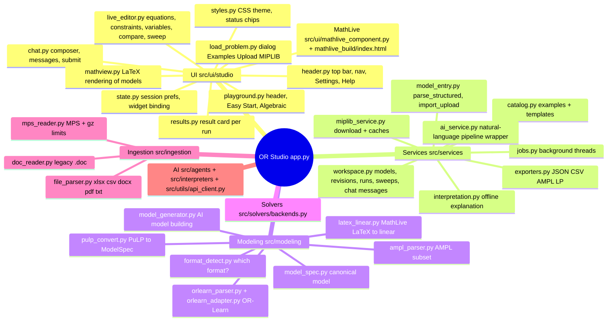

# OR Studio: Project Map (for AI-assisted changes)

> **For the AI reading this:** this file maps the whole OR Studio codebase.
> The user will paste it, then describe something they saw in the browser that
> they want changed. Your first reply should:
>
> 1. Restate the change in one line.
> 2. List the **smallest set of files** the user needs to paste (usually 1–3),
>    using the tables below. Name specific functions where possible, so the user
>    can paste only those parts of very large files.
> 3. Say which **optional** files would help, and why.
>
> Don't ask for files that aren't needed; the user is saving tokens. Never ask for
> `.env`, because it holds API keys. After the user pastes the files, give exact
> edits (old → new) that match the existing code style.

---

## 1. What the app is

OR Studio is a Streamlit web app for operations research (LP/MIP) models.

- **Chat** (`?view=chat`) has one composer that accepts natural language,
  OR-Learn Python-style chains, or AMPL-style models. Results appear inline as
  cards.
- **Model Playground** (`?view=playground`) has three tabs:
  - **Easy Start**: templates.
  - **Algebraic**: source on one side, expanded math preview on the other.
  - **Live Editor**: MathLive equations, a symbols keypad, a variables table,
    compare, and sweep.
- **Load Problem** is a dialog with Examples, Upload and MIPLIB tabs. It opens
  from both views.
- **Solvers**: Auto, CBC (PuLP), OSQP (CVXPY), GLPK (CVXOPT) and SCIP
  (PySCIPOpt).
- **AI** (OpenAI/Anthropic) is used only for natural-language input. Everything
  else runs offline.
- Entry point: `app.py`. The old interface is preserved in `legacy_app.py`.

Run it: `.\venv\Scripts\python.exe -m streamlit run app.py`, then open
<http://localhost:8501>. Streamlit reloads on save; press **R** in the browser
or use "Rerun" if it doesn't.

---

## 2. Mind map



### Data flow: what happens when you press Solve

```
Composer text ──► chat.submit() ──► chat.process()
                     │                 ├─ format_detect.detect_format()
                     │                 ├─ structured → model_entry.parse_structured()
                     │                 │     ├─ AMPL    → ampl_parser.parse_ampl_detailed()
                     │                 │     └─ OR-Learn→ orlearn_parser + orlearn_adapter
                     │                 │   → workspace.add_model() → workspace.submit_run()
                     │                 │        → jobs.submit(thread) → backends.solve_spec()
                     │                 └─ natural → ai_service.run_natural_language() (needs key)
app.py each rerun: workspace.poll() + chat.poll_messages() pick up finished jobs
results.render_run() draws the card (status, objective, expanders, exports)
```

**State model** (`workspace.py`): a `ModelRecord` holds an immutable
**baseline** (revision `r0`), an editable **working** spec, and frozen
**revisions** (`r1`, `r2`, …). Each **Run** points at the exact revision it
solved. A **Sweep** solves copies and never changes the working spec. Chat
history is `Workspace.messages`.

---

## 3. "I see X in the browser" → files to provide

| What you see / want to change | Paste these | Optional |
|---|---|---|
| Colors, fonts, spacing, widths, focus rings, mobile layout | `src/ui/studio/styles.py` | `.streamlit/config.toml` (base theme colors) |
| Status chip colors and labels (Optimal, Feasible, …) | `styles.py` (`STATUS`, `chip`) | |
| Top bar: logo, Chat / Model Playground switch, model name, Settings, Help | `src/ui/studio/header.py` | `styles.py` (`.st-key-ors_topbar`, `.ors-brand`) |
| Settings popover (default solver, time limit, provider status) | `header.py` (`settings_panel`) | `state.py` (`DEFAULTS`) |
| Help popover text | `header.py` (`help_panel`) | |
| Chat empty screen ("What would you like to optimize?") | `src/ui/studio/chat.py` (`render_empty`) | `styles.py` (`.ors-hero`) |
| Composer: textarea, format control, solver select, Solve button, Ctrl+Enter | `chat.py` (`render_composer`, `CTRL_ENTER_JS`, `PLACEHOLDER`) | |
| What happens on submit; format detection; parse-error and credentials messages | `chat.py` (`submit`, `process`, `render_reply`) | `src/modeling/format_detect.py` |
| "Ambiguous, choose a format" behavior | `format_detect.py`, `chat.py` (`choose_format`) | |
| Result card: metrics, key decisions, expanders, Open in Playground, exports | `src/ui/studio/results.py` (`render_run`, `_details`) | `src/services/interpretation.py` (summary text), `src/services/exporters.py` |
| Charts inside results | `results.py` (`_details`, Charts section) | |
| Plain-language explanation text | `src/services/interpretation.py` | |
| Progress / "Solving…" / Cancel button | `results.py` (`_live_progress`), `chat.py` (`job_progress`) | `src/services/jobs.py` |
| Load Problem dialog (any tab) | `src/ui/studio/load_problem.py` | |
| Examples list / categories / example text | `src/services/catalog.py` (`EXAMPLES`) | |
| Easy Start template cards or template models | `src/ui/studio/playground.py` (`render_easy_start`), `catalog.py` (`TEMPLATES`) | |
| Playground header (name, status, solver, Models switcher) | `playground.py` (`render_header`) | |
| "Unsaved edits, Keep Editing / Load Template" dialog | `playground.py` (`confirm_replace`, `_needs_confirm`) | |
| Algebraic tab (editor, preview, errors, OR-Learn API shown) | `playground.py` (`render_algebraic`, `_render_alg_preview`) | `src/services/model_entry.py` |
| How math is displayed (aligned equations, names, bounds) | `src/ui/studio/mathview.py` | `src/modeling/latex_linear.py` (`linear_to_latex`) |
| Live Editor: objective row, constraint rows, relation/RHS, row menu, Add Constraint | `src/ui/studio/live_editor.py` (`render`, `_equation_editor`, `_set_*`) | |
| Live Editor variables table (domain, LB, UB, rename, delete prompt) | `live_editor.py` (`_render_variables`, `_vars_changed`, `_render_delete_prompts`) | `workspace.py` (`rename_variable`, `remove_variable`) |
| Solve Edited Model / Preview Math / Reset to Baseline bar | `live_editor.py` (`_solve`, `_reset`, `_toggle_preview`) | `styles.py` (`.st-key-le_actions`) |
| Compare view / history / sensitivity sweep | `live_editor.py` (`_render_compare`, `_render_history`, `_render_sweep`) | `workspace.py` (`compare`, `start_sweep`) |
| **MathLive field or Symbols keypad** (keys, look, Escape, sizing) | `src/ui/mathlive_build/index.html` | `src/ui/mathlive_component.py`, `live_editor.py` (`_palette`) |
| Typed math is accepted or rejected wrongly ("Not applied") | `src/modeling/latex_linear.py` | `live_editor.py` (`_apply_latex`) |
| AMPL syntax support / error messages | `src/modeling/ampl_parser.py` | `docs/AMPL_SUBSET.md` |
| OR-Learn syntax support / what is allowed | `src/modeling/orlearn_parser.py` | `src/modeling/orlearn_adapter.py` (library calls) |
| Solver choice, Auto rules, solver errors, time limit, cancel | `src/solvers/backends.py` | `header.py` (`solver_options`) |
| Upload accepts or rejects a file / size limits | `src/services/model_entry.py` (`import_upload`) | `src/ingestion/file_parser.py`, `doc_reader.py`, `mps_reader.py` |
| MPS parsing problems | `src/ingestion/mps_reader.py` | |
| MIPLIB list, download, cache, Clear cache | `src/services/miplib_service.py` | `load_problem.py` (`_miplib_tab`), `src/storage/miplib_cache.py` |
| Natural-language (AI) pipeline errors | `src/services/ai_service.py` | `src/agents/problem_classifier.py`, `src/modeling/model_generator.py`, `src/utils/api_client.py` |
| AI provider / model / API key handling | `src/utils/api_client.py`, `ai_service.py` (`provider_status`) | `.env.example` (never `.env`) |
| Draft lost / wrong tab after rerun / widget resets | `src/ui/studio/state.py` | the screen's file |
| Page title, icon, routing order | `app.py` | |
| Command line tool | `cli.py` | |
| Old interface (`legacy_app.py`) | `legacy_app.py` (paste only the relevant section; it is ~2000 lines) | legacy-only modules (section 5.9) |

---

## 4. Common change recipes

- **Rename a button or label:** find the text in the screen's file from
  section 3 (search for the exact words). Usually it's one file.
- **Add a template:** `catalog.py` (add the AMPL text and a `TEMPLATES` entry).
  Nothing else is needed.
- **Add an example:** `catalog.py` (`EXAMPLES`, with `category`, `format`,
  `text`, `expected`).
- **Add a keypad key:** `mathlive_build/index.html` (the `COMMON` or `MORE`
  arrays). If the parser must understand it, also `latex_linear.py`.
- **Add a solver:** `backends.py` (`SOLVERS`, `SOLVER_ORDER`, `availability`,
  plus a `_solve_*` runner). The UI picks it up automatically.
- **Add an export format:** `exporters.py`, plus the Exports section in
  `results.py` (`_details`).
- **Support a new AMPL construct:** `ampl_parser.py` (both the `_Parser` and the
  `_Expander`), plus a test in `tests/test_studio_core.py`.
- **New result field or metric:** `backends.py` (`_result` / runner) and
  `results.py`.
- **Change default solver or time limit:** `state.py` (`DEFAULTS`).
- **Change the theme everywhere:** `styles.py` (`TOKENS` plus the CSS in
  `inject`) and `.streamlit/config.toml`.

---

## 5. Every file explained

### 5.1 Entry points and config

| File | Purpose |
|---|---|
| `app.py` | Main entry. Loads `.env`, sets the page config, then on every rerun: polls background jobs, syncs `?view=`, injects CSS, draws the header, routes to Chat or Playground, and opens the Load Problem dialog if requested. |
| `legacy_app.py` | The previous all-in-one UI (tabs, sidebar, dark playground), kept runnable. Not used by `app.py`. |
| `cli.py` | Click CLI: `solve`, `validate`, `examples`, `solvers`. Uses the same services as the UI. |
| `setup.py` | Packaging; installs `requirements-runtime.txt`; console scripts `or-studio` / `or-assistant`. |
| `setup_tests.py` | Old environment self-check script (legacy). |
| `.streamlit/config.toml` | Streamlit theme (primary `#1D4ED8`, page `#F6F8FB`), minimal toolbar, 25 MB upload limit. |
| `requirements-runtime.txt` | Production dependencies (incl. the OR-Learn pin). `requirements-dev.txt` adds pytest and Playwright. `requirements.txt` is the broad legacy set. |
| `Dockerfile`, `render.yaml` | Container image (Python 3.12, non-root, health check) and Render blueprint. Not deployed. |
| `.env` / `.env.example` | API keys and `AI_PROVIDER`. **Never share `.env`.** |

### 5.2 UI: `src/ui/studio/` (the new interface)

| File | Purpose | Key functions |
|---|---|---|
| `state.py` | Session helpers. `ws()` returns the `Workspace`. `pref`/`set_pref` store persistent preferences (`pref_<name>`). `bound()` mirrors a pref into a widget key `w_<key>` so values survive reruns and view switches. `flash` shows toasts. `epoch` / `bump_epoch` force widgets to reset after external changes. `go(view, tab)` navigates. | `DEFAULTS`, `bound`, `go` |
| `styles.py` | All CSS (light theme, widths: chat 880px, playground 1240px; sticky bars; focus rings; mobile rules) and status chips. `css()` injects a style block that persists; plain style-only `st.html` would disappear on rerun. | `TOKENS`, `STATUS`, `chip`, `inject`, `css` |
| `header.py` | Sticky top bar: brand, segmented Chat / Model Playground nav, active model chip, Settings and Help popovers. Also solver option helpers used elsewhere. | `render`, `settings_panel`, `help_panel`, `solver_options` |
| `chat.py` | The Chat view: empty state, message list (submissions and replies of each kind: `choose_format`, `parse_error`, `credentials`, `ai_job`, `library_run`, `miplib_load`, `run`), composer toolbar, Ctrl+Enter, duplicate-submit guard, background AI and MIPLIB job folding. | `render`, `render_composer`, `submit`, `process`, `render_reply`, `poll_messages` |
| `results.py` | One result card per `Run`: status/objective/solver/time/gap metrics, key decisions, offline summary, expanders (Variables, Constraints, Charts, Interpretation, Diagnostics, Exports), Open in Playground, Re-solve, and a live progress fragment with Cancel (SCIP only). Paged tables for large models. | `render_run`, `_details`, `paged_table`, `_live_progress` |
| `load_problem.py` | The Load Problem dialog: Examples (category pills, Use in Chat / Open in Algebraic), Upload (validated import; a failure keeps the active model), MIPLIB (Recommended / Browse / By name / Cached, download progress, then a separate solve). | `dialog`, `_examples_tab`, `_upload_tab`, `_miplib_tab`, `start_miplib_load` |
| `playground.py` | Model Playground: header (name, source, size, solver, Models switcher), tab switch, Easy Start (cards, preview, Solve Template, Edit in Live Editor, replace-confirmation dialog), Algebraic (source and preview, hash-guarded actions, OR-Learn API chain, sets/params/indexed variables). Delegates the Live Editor tab to `live_editor.py`. | `render`, `render_header`, `render_easy_start`, `render_algebraic`, `confirm_replace` |
| `live_editor.py` | The Live Editor: objective sense and expression, constraint rows (name, expression via MathLive, relation, RHS, ⋮ menu), new constraint form, variables data editor (bounds as text with ∞), delete-impact prompts, action bar, current run, compare, sweep, history. Widget keys look like `le_{model}_{epoch}_{name}`. | `render`, `_equation_editor`, `_apply_latex`, `flush_active`, `_render_variables`, `_solve`, `_reset`, `_render_compare`, `_render_sweep` |
| `mathview.py` | Turns a `ModelSpec` into aligned LaTeX with real names (objective, constraints with names, bounds, domains). Used by previews and Preview Math. | `model_latex`, `show_model` |

### 5.3 MathLive component

| File | Purpose |
|---|---|
| `src/ui/mathlive_component.py` | Python wrapper `mathlive_editor(label, initial_latex, mode, variables, read_only, focus_token, key)` that returns the LaTeX typed. Also used by `legacy_app.py`. |
| `src/ui/mathlive_build/index.html` | The iframe page: the math field, Symbols toggle, keypad groups (Common, Variables, More), blocked keys with reasons, Escape and keyboard handling, debounced value sending, auto height. Inline shortcuts are limited to `<= >= != *`. |
| `src/ui/mathlive_build/vendor/` | Vendored `mathlive.min.js` plus fonts (MIT). Don't edit. |

### 5.4 Services: `src/services/`

| File | Purpose | Key items |
|---|---|---|
| `workspace.py` | The core state machine: `ModelRecord` (baseline/working/revisions), `Run`, `Sweep`, chat `messages`. Holds every edit operation (`set_rhs`, `set_relation`, `set_constraint_expression`, add/rename/remove constraint and variable, `set_objective`), `freeze`, `submit_run` (deduplicates pending runs, MIPLIB cache, OR-Learn cross-check), `poll`, `compare`, `start_sweep`, `reset_to_baseline`, `open_revision`, and `diff_specs`. | `Workspace`, `EditError` |
| `model_entry.py` | `parse_structured(text, fmt)` returns a `ParseOutcome` (spec or line/column error) for `orlearn` and `ampl`. `import_upload(filename, bytes)` returns an `ImportOutcome` (model, document or error) with size limits. | `MAX_UPLOAD_BYTES`, `UPLOAD_TYPES` |
| `jobs.py` | Thread-based background jobs with progress, a cancel event and a solver handle, so the UI never blocks. | `submit`, `get`, `Job` |
| `catalog.py` | All built-in model texts: OR-Learn README examples (attributed), AMPL examples, natural-language descriptions (`NL`), the `EXAMPLES` list by category, and the six Easy Start `TEMPLATES`. | `EXAMPLES`, `TEMPLATES`, `example`, `template` |
| `interpretation.py` | Offline plain-language summary of a result (optimal vs. time-limited feasible, binding constraints, key decisions) and the `fmt` number formatter. | `fmt` |
| `exporters.py` | Exports: `result_json`, `variables_csv`, `constraints_csv`, `spec_to_ampl`, `spec_to_lp`. | |
| `miplib_service.py` | MIPLIB 2017: name validation, recommended (easy) list, streamed download with progress and cancel, file cache under `data/miplib`, solution cache (SQLite via `storage/miplib_cache.py`), clearing. | `download`, `load_spec`, `easy_instances` |
| `ai_service.py` | `provider_status()` (is a real key configured?) and `run_natural_language()` (classify → generate PuLP → convert → solve), run inside a job. | |
| `model_playground.py` | Legacy-only orchestration (used by `legacy_app.py`). | |

### 5.5 Modeling: `src/modeling/`

| File | Purpose |
|---|---|
| `model_spec.py` | The canonical model: `LinearExpression`, `VariableSpec`, `ConstraintSpec`, `ObjectiveSpec`, `ModelSpec` (validate, stats, fingerprint, `with_uids` for stable `v1…`/`c1…` IDs, `issues`). Everything converts to this. |
| `format_detect.py` | `detect_format(text)` returns `orlearn`, `ampl`, `natural`, `ambiguous` or `empty`, with reasons. Edit this when Auto guesses wrong. |
| `ampl_parser.py` | Tokenizer, recursive-descent parser and expander for the AMPL subset (sets, params, indexed variables and constraints, `sum{}`, ranges, data section). Errors carry line and column. See `docs/AMPL_SUBSET.md`. |
| `orlearn_parser.py` | AST-based safe reader of OR-Learn chains. It never executes code. It allows `orlearn` imports, literals, chain methods, and display `print`s (skipped). |
| `orlearn_adapter.py` | Builds models through the real OR-Learn library (pinned commit), records the invoked API, reports library info, and runs the `reference_solve` cross-check. |
| `latex_linear.py` | LaTeX ↔ linear expression for MathLive: `latex_to_linear`, `latex_to_constraint`, `linear_to_latex`, `latex_names`. Rejects nonlinear input or unknown names with `LatexError`. |
| `pulp_convert.py` | PuLP problem → `ModelSpec` (used after the AI generates a PuLP model). |
| `model_generator.py` | AI-era model builder: turns classified problem data into PuLP models (large; used by the natural-language pipeline). |
| `linear_expression.py`, `model_formatter.py`, `playground_parser.py`, `playground_examples.py`, `pulp_builder.py` | Legacy-only helpers for `legacy_app.py`. |

### 5.6 Solvers: `src/solvers/`

| File | Purpose |
|---|---|
| `backends.py` | **The solver layer of the new app.** `SOLVERS` and `SOLVER_ORDER`, `availability()`, `compatibility()` (for example OSQP refuses MIP), `resolve()` (Auto rules and explanation), `solve_spec(spec, key, time_limit, cancel, handle)`, with the CBC, CVXPY (OSQP/GLPK) and SCIP runners. Returns a result dict (`status`, `kind`, `objective`, `variables`, `constraints` with slack/dual, `gap`, `backend`, `explanation`, `elapsed`). |
| `solver_interface.py`, `solver_router.py` | Legacy solver layer used by `legacy_app.py`. |

### 5.7 Ingestion and storage

| File | Purpose |
|---|---|
| `src/ingestion/file_parser.py` | Extracts text and tables from xlsx/xls/csv/docx/doc/pdf/txt. |
| `src/ingestion/doc_reader.py` | Plain-text extraction from old Word `.doc` (OLE) files. |
| `src/ingestion/mps_reader.py` | MPS/MPS.gz → `ModelSpec` (OBJSENSE, RANGES, bounds), with a decompression-size limit and clear `MPSError`s. |
| `src/ingestion/data_extractor.py` | AI analysis of parsed file content (natural-language path). |
| `src/ingestion/miplib_loader.py` | Legacy MIPLIB loader (`legacy_app.py`). |
| `src/storage/miplib_cache.py` | SQLite solution cache used by `miplib_service.py`. |

### 5.8 AI pipeline (only for natural language; needs an API key)

| File | Purpose |
|---|---|
| `src/utils/api_client.py` | One client for Anthropic and OpenAI (model names, temperature handling, errors). |
| `src/agents/problem_classifier.py` | AI step 1: classify the problem type and extract parameters. |
| `src/modeling/model_generator.py` | AI step 2: build a PuLP model from the extracted data. |
| `src/interpreters/result_interpreter.py` | AI interpretation of results (the optional "provider" part of Interpretation). |
| `src/utils/solver_utils.py` | Detects installed solvers (used by Settings/Help). |

### 5.9 Legacy-only and unused

- **Used only by `legacy_app.py`:**
  - `src/ui/model_components.py`, `solver_progress.py`, `solver_settings.py`
    and `theme.py`
  - `src/utils/model_editor.py`
  - `src/visualization/chart_generator.py`
  - `src/solvers/solver_interface.py` and `solver_router.py`
  - `src/ingestion/miplib_loader.py`
  - the legacy modeling helpers listed in 5.5
- **Not imported by anything:** `src/ui/modern_app.py` and `src/ui/session.py`
  (an earlier modernization attempt). It's safe to ignore them.
- `src/simulation/`: an empty package placeholder.

### 5.10 Tests

| File | What it covers |
|---|---|
| `tests/test_studio_core.py` | Parsing every example, LaTeX, all 5 backends on the fixture, workspace (2200 → 2100, −100, sweep 2100/2150/2200, reset, revisions, late completion), uploads of every type and failure cases, exports, MIPLIB (`network` marker). |
| `tests/test_studio_app.py` | AppTest smoke tests of `app.py` (start, OR-Learn solve, no-credentials, parse error, Playground tabs). |
| `tests/test_playground.py`, `tests/test_solver.py` | Older parser and solver tests (still passing). |
| `tests/test_streamlit_app.py` | Smoke tests for `legacy_app.py`. |
| `tests/browser/test_e2e.py` + `conftest.py` | 19 Playwright end-to-end tests against a running server (`ORSTUDIO_URL`, default `localhost:8501`). Screenshots go to `artifacts/screens/`. |
| `tests/browser/shot_before.py` | Captures legacy "before" screenshots. |
| `tests/test_phase*.py`, `test_classifier.py`, `test_llm_connect.py`, `debug_classifier.py` | Old AI-era scripts (need API keys; not part of the offline suite). |
| `tests/fixtures/uploads/` | `fixture.mps`, `corrupt.mps.gz`, real `.doc`/`.xls` samples. |

### 5.11 Docs

- `README.md`: features, run, production, tests, syntax, CLI.
- `docs/AMPL_SUBSET.md`: exact supported and rejected AMPL constructs.
- `docs/AI_CONVERSION.md`: design for future AI → AMPL conversion.

---

## 6. Gotchas the AI must know before editing

1. **Streamlit reruns the whole script** on every interaction. Persistent values
   live in `st.session_state`. Use `state.pref`/`set_pref`/`bound`; don't
   create new ad-hoc keys for the same thing.
2. **Never set a widget's session value after the widget is created** in the
   same run. Set it before the widget or in an `on_click`/`on_change` callback,
   or set a flag and call `st.rerun()`.
3. **Widget keys include an epoch** (`le_{mid}_{epoch}_…`). Call
   `state.bump_epoch(mid)` after external model changes (reset, load, open
   revision) so the widgets show the new values.
4. **CSS:** add rules inside `styles.inject()` or use `styles.css(...)`. A bare
   `st.html("<style>…</style>")` vanishes on rerun. Widgets with `key="x"` get
   the CSS class `.st-key-x`.
5. **Runs are immutable.** Never write results into the working spec; look
   results up by revision (`workspace.latest_run`, `current_run`).
6. **Nothing typed by the user is executed.** Parsers are AST- or
   tokenizer-based; keep it that way, and never use `eval` or `exec`.
7. **Structured parse failures must not go to the AI** (`chat.process`).
8. **MathLive runs in an iframe** (`index.html`). Python only receives LaTeX
   strings, so UI changes inside the editor go in `index.html`.
9. Long work (solves, downloads, AI) must go through `jobs.submit` so the UI
   stays responsive. Progress UIs use `@st.fragment(run_every=…)`.
10. After a change, run
    `.\venv\Scripts\python.exe -m pytest tests --ignore=tests/browser -m "not network" -q`.
    For UI changes, also run `pytest tests/browser -k <area>` with the app
    running.

---

## 7. Live-testing loop (cheap on tokens)

1. Start the app: `.\venv\Scripts\python.exe -m streamlit run app.py`.
2. Find what you dislike in the browser and look it up in **section 3**.
3. Paste this file and describe the change. The AI replies with the files (and
   functions) it needs.
4. Paste only those files or functions, then apply the edits it returns.
5. Save. Streamlit offers **Rerun** (or press **R**), so you can check the
   change right away.
6. If something breaks, paste the red error box text plus the one file it
   names.
